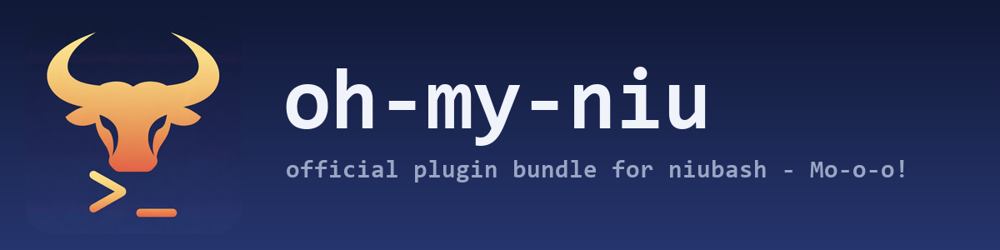

# Oh My Niu

<p align="center">
  
</p>


Official Oh My-style plugin framework and bundled plugin distribution for
Niubash.

This repository is not a zsh runtime and does not provide zsh plugin
compatibility. It should, however, follow the useful shape of Oh My Zsh, fish
plugin managers, and PowerShell prompt frameworks: plugins are directories,
themes are plugins, and the shell core provides loader primitives instead of
owning high-level plugin behavior.

## Moo

The niubash bull ships with the bundle. Source `oh-my-niu.niu` from your
`~/.niubashrc` and it can talk:

```sh
niu_moo "Bash, native on Windows."   # cowsay-style bubble
niu_banner                           # block-letter NIUBASH mark
```

Set `NIU_BANNER=1` in `~/.niubashrc` to greet every interactive shell with
the banner. The entry point is re-entrant: sourcing `oh-my-niu.niu` twice
is a no-op; force a full reload with
`source "$NIUBASH/oh-my-niu.niu" --reload`.

## Status

The active direction is framework-first. See [docs/design.md](docs/design.md).
The earlier manifest-first bundle design is retired in
[docs/design-manifest-first-retired.md](docs/design-manifest-first-retired.md).

- Niubash owns shell primitives, the plugin spec and generated loader
  for external ecosystem sources (`~/.niubash/plugins.toml`), and fast
  native helpers.
- `oh-my-niu` owns framework libraries, plugin directories, themes,
  default composition, the lifecycle wiring onto the bash prompt
  surface (PROMPT_COMMAND / DEBUG trap), and the official bundled
  distribution.
- The bundle does not ship inside Niubash releases: Niubash retired
  its built-in plugin/theme stack (niubash#145), and this repository
  is installed and updated on its own.
- `plugin.toml` is metadata for packaging, review, and updates. It should not be
  the only way to express local trusted shell behavior.

## Framework Model

The target interactive setup is directory-first and familiar:

```sh
NIU_PLUGINS=(prompt-core git docker zoxide)
NIU_THEME=minimal
source "$NIUBASH/oh-my-niu.niu"
```

Starship can also own the prompt through its normal Bash init path. In that
mode, load the `starship` plugin instead of `prompt-core`/`theme-*` prompt
plugins so Starship controls `PROMPT_COMMAND`, `PS1`, `PS2`, and `PS0`:

```sh
NIU_PLUGINS=(git starship docker zoxide)
NIU_THEME=
source "$NIUBASH/oh-my-niu.niu"
```

Niubash's own plugin system does not manage this bundle. Current
Niubash installs external ecosystem sources (oh-my-bash, bash-it,
bash-completion, wild file sources) declared in
`~/.niubash/plugins.toml`:

```toml
schema = "niubash:plugin-spec@0.1.0"

[[sources]]
target = "oh-my-bash"        # catalog id | owner/repo | git url | local path
enable = ["git", "npm"]      # manager-native selection
theme  = "agnoster"          # optional; absent = unmanaged
```

oh-my-niu is not one of those sources. It is a framework you clone and
source from `~/.niubashrc`, and its plugin/theme selection stays in
the rc variables above; the `[plugins]`/`[theme]` TOML shape older
versions of this README showed was never a format Niubash reads.
Bundle updates are manual: `git pull` in the clone, or download the
newer release zip from this repository's GitHub releases and unpack
it over the old tree. The `niu plugin update oh-my-niu --from <zip>`
and `niu plugin rollback oh-my-niu` flow belonged to the retired
built-in stack; current `niu plugin update` / `niu plugin rollback`
operate on ecosystem sources in `~/.niubash/plugins.toml`, not on
this bundle.

User shell code and normal plugin/theme selection belong in
`~/.niubashrc`. Current Niubash never reads `~/.winshrc` or
`~/.winuxshrc` — they are not fallbacks for a missing `~/.niubashrc`;
the only rc fallback is an explicitly opted-in `~/.bashrc`
(see `niu setup --rc-policy`):

```sh
alias ll='ls -la'
export EDITOR=vim
```

## Environment Packs

Environment packs ("envs") provision a ready-to-use tool environment. An env
is a small TOML file (not a plugin kind) that declares which WPM packages to
install, which shell plugins to enable, and which environment variables to
export. wpm owns package installation; `lib/env.niu` only orchestrates.

`niu_env` is a shell function defined by `lib/env.niu` once the
framework is sourced — there is no `niu env` host subcommand:

```sh
niu_env list          # list built-in and custom envs
niu_env show git      # inspect without changing anything
niu_env use git       # install packages, enable plugins, export variables
```

An env file looks like this:

```toml
[meta]
description = "Native Git toolchain with pager, diff, and fetch reminders"

[packages]
wpm = ["git", "delta"]

[plugins]
enable = ["git", "git-fetch-reminder"]

[env]
GIT_PAGER = "less -R"
```

`niu env use` accepts a name under `envs/` (or `~/.niubash/custom/envs/`), a
path to any `.toml` file, or an `http(s)://` URL, so third parties can ship
their own env files without publishing them in this repository. CI containers
that do not source the framework can call `wpm install --from <file|URL>`
directly; the `[packages]` section is consumed by wpm itself.

## Repository Layout

```text
oh-my-niu/
  oh-my-niu.niu
  bundle.toml
  index.toml
  envs/
    git.toml
    cicd.toml
  lib/
    aliases.niu
    git.niu
    prompt.niu
    hooks.niu
    env.niu
plugins/
    prompt-core/
      prompt-core.plugin.niu
      plugin.toml
    git/
      git.plugin.niu
      plugin.toml
      functions/
      completions/
    theme-minimal/
      theme-minimal.plugin.niu
      plugin.toml
    theme-default/
    theme-dark/
    theme-light/
    theme-colorful/
    theme-classic/
    theme-pure/
    theme-compact/
    theme-cyberpunk/
    theme-forest/
    theme-ocean/
    theme-agnoster/
    theme-avit/
    theme-bira/
    theme-clean/
    theme-fishy/
    theme-lambda/
    theme-p10-lean/
    theme-p10-classic/
    theme-p10-rainbow/
    theme-p10-pure/
    theme-robbyrussell/
    theme-dracula/
    theme-catppuccin-mocha/
    theme-gruvbox/
    theme-spaceship/
    theme-tokyonight/
    common-aliases/
    path-tools/
    extract/
    docker/
    kubectl/
    npm/
    zoxide/
    direnv/
    dotenv/
    fzf/
    last-working-dir/
    thefuck/
    keybindings/
    command-not-found/
  packs/
    ...
    # Transitional manifest-first compatibility surface.
  aliases/
    common-aliases.toml
    git.toml
    docker.toml
    kubectl.toml
    npm.toml
    README.md
  completions/
    git.toml
    docker.toml
    kubectl.toml
    npm.toml
    README.md
  prompts/
    segments.toml
    README.md
  keybindings/
    common.toml
    emacs.toml
    vi.toml
    README.md
  themes/
    default.toml
    dark.toml
    light.toml
    colorful.toml
    cyberpunk.toml
    classic.toml
    compact.toml
    forest.toml
    minimal.toml
    ocean.toml
    p10-lean.toml
    p10-classic.toml
    p10-rainbow.toml
    p10-pure.toml
    pure.toml
    robbyrussell.toml
    README.md
  docs/
    authoring.md
    design.md
    framework-smoke-notes.md
    design-manifest-first-retired.md
    migration.md
    roadmap.md
  templates/
    builtin/plugin.toml
    source/plugin.toml
    source/init.niu
    process/plugin.toml
    wasm/plugin.toml
```

## First-Party Plugins

These are the active Oh My-style plugin directories. Themes are regular
plugins, and `prompt-core` owns the common prompt API.

| Plugin | Purpose | Default |
| --- | --- | --- |
| `prompt-core` | Prompt API, segment registry, and Git status prompt service | On |
| `theme-default` | Official default theme plugin | Off |
| `theme-dark` | Official dark theme plugin | Off |
| `theme-light` | Official light theme plugin | Off |
| `theme-colorful` | Official colorful theme plugin | Off |
| `theme-minimal` | Minimal official prompt theme plugin | On |
| `theme-classic` | Classic two-line official prompt theme plugin | Off |
| `theme-pure` | Pure-inspired two-line official prompt theme plugin | Off |
| `theme-compact` | Compact single-line official prompt theme plugin | Off |
| `theme-cyberpunk` | Cyberpunk official prompt theme plugin | Off |
| `theme-forest` | Forest official prompt theme plugin | Off |
| `theme-ocean` | Ocean official prompt theme plugin | Off |
| `theme-agnoster` | Agnoster-style Nerd Font prompt theme plugin | Off |
| `theme-avit` | Avit-style Oh My Zsh prompt theme plugin | Off |
| `theme-bira` | Bira-style two-line Oh My Zsh prompt theme plugin | Off |
| `theme-clean` | Clean Oh My Zsh prompt theme plugin | Off |
| `theme-fishy` | Fish-like prompt theme plugin inspired by Oh My Zsh and fish-shell | Off |
| `theme-lambda` | Lambda-style minimal Oh My Zsh prompt theme plugin | Off |
| `theme-p10-lean` | Powerlevel-style lean prompt theme plugin | Off |
| `theme-p10-classic` | Powerlevel-style classic prompt theme plugin | Off |
| `theme-p10-rainbow` | Powerlevel-style rainbow prompt theme plugin | Off |
| `theme-p10-pure` | Powerlevel-style pure prompt theme plugin | Off |
| `theme-robbyrussell` | Robby Russell-style prompt theme plugin | Off |
| `theme-dracula` | Dracula Nerd Font prompt theme plugin inspired by Oh My Posh | Off |
| `theme-catppuccin-mocha` | Catppuccin Mocha Nerd Font prompt theme plugin inspired by Oh My Posh | Off |
| `theme-gruvbox` | Gruvbox Nerd Font prompt theme plugin inspired by Oh My Posh | Off |
| `theme-spaceship` | Spaceship-style Nerd Font prompt theme plugin inspired by Oh My Posh | Off |
| `theme-tokyonight` | Tokyo Night Nerd Font prompt theme plugin inspired by Oh My Posh | Off |
| `starship` | Full Starship prompt integration through the Bash prompt contract | Off |
| `git` | Git aliases, completions, and workflow helpers | On |
| `winuxcmd-core` | Static completions for WinuxCmd core command links | On |
| `common-aliases` | Small Oh My-style navigation/listing aliases | Off |
| `docker` | Docker `.niu` helpers, aliases, completion metadata | Off |
| `kubectl` | Kubernetes `.niu` helpers, aliases, completion metadata | Off |
| `npm` | npm `.niu` helpers, aliases, runtime completion shape | Off |
| `path-tools` | PATH inspection and edit helpers inspired by fish ergonomics | Off |
| `extract` | Archive extraction helper for common compressed formats | Off |
| `zoxide` | `.niu` `z`/`zi` helpers plus directory tracking hooks | Off |
| `direnv` | `.niu` lifecycle adapter for `direnv export bash` | Off |
| `dotenv` | `.niu` `.env` loader for current project directory | Off |
| `fzf` | `.niu` directory selector command shims | Off |
| `last-working-dir` | `.niu` last-directory cache and restore hooks | Off |
| `thefuck` | `.niu` correction shim for the previous command | Off |
| `keybindings` | Bridge plugin for official Reedline keybinding assets | On |
| `command-not-found` | Bridge plugin for the missing-command provider identity | Off |

## Transitional Packs

`packs/`, `aliases/`, `completions/`, `prompts/`, `keybindings/`, and
`themes/` remain in the repository as packaging and review metadata
for this bundle's own validator. Current Niubash does not load them —
the manifest-first bundle layout was a contract with the retired
built-in plugin stack (niubash#145). New behavior should land in
`plugins/<name>/` first, then expose metadata through TOML for
review.

The old `prompts` and `themes` packs are compatibility assets. They are no
longer the product model for prompt and theme behavior; `prompt-core` and
`theme-*` plugins are.

## Authoring

Public authoring is moving to plugin directories. During the transition,
[docs/authoring.md](docs/authoring.md) still describes the manifest-backed
bundle surface and templates, but new user-facing behavior should start as
plugin-owned code/assets rather than Niubash `builtin` packs.

```sh
python tools/validate_bundle.py
python tools/package_bundle.py --check
```

`plugin.toml` remains useful for package metadata, permissions, exports, and
required binaries before Niubash runs distributed plugin code. It should be a
review/install surface over plugin directories, not the product identity.

## Legacy

The old repository content was a `.winsh` script framework from a previous
WinSH era. It is preserved through the `legacy-pre-niubash-plugin-system`
branch/tag; the active branch describes the official Niubash plugin bundle.

See [docs/migration.md](docs/migration.md).

## Roadmap

The active product direction lives in [docs/design.md](docs/design.md). The old
phase roadmap remains in [docs/roadmap.md](docs/roadmap.md) as manifest-first
history until the framework-first migration plan replaces it.
Release compatibility is tracked in [docs/compatibility.md](docs/compatibility.md),
and bundle changes are tracked in [CHANGELOG.md](CHANGELOG.md).

## Validation And Packaging

```sh
python tools/validate_bundle.py
python tools/package_bundle.py --check
# Windows launcher:
py tools\validate_bundle.py
py tools\package_bundle.py --check
# Runtime smoke with the selected Niubash binary:
niubash tools/smoke_framework.niu .
```

The validator checks release documents, package index drift, release checksum
policy, bundle API and minimum Niubash metadata, old manifest inventory drift,
directory plugin inventory drift, plugin entry scripts, plugin metadata,
exported asset presence, parseable alias packs, parseable completion
definitions, prompt preset segment references, declarative keybinding metadata,
and theme TOML assets. Source manifests must declare `shell:source`, supported
lifecycle hooks, and a bundle-local `.niu` entry. Process manifests must be
explicit opt-in and declare protocol, command, timeout, permissions, and
required binaries. The package script builds
`dist/oh-my-niu-{version}.zip` plus a `.sha256` checksum when run without
`--check`.
WASM manifests must also declare a bundle-local `.wasm` module path and SHA-256;
the validator checks that the artifact exists, matches the digest, and has a
valid WASM binary header. That validation is bundle-side only: current
Niubash does not execute plugin WASM or process modules — the
process/WASM plugin execution model was part of the retired built-in
stack (niubash#145), and no host code loads `niubash_plugin_main` or
the `niubash:plugin/host` imports anymore. Treat process/WASM pack
metadata as archival until a host grows a new provider API.

Local release smoke test (manual — there is no host-side bundle
installer anymore):

```sh
py tools\package_bundle.py
:: unpack dist\oh-my-niu-<version>.zip into a scratch directory, then
:: in Niubash, with NIUBASH pointing at the unpacked tree:
niubash tools\smoke_framework.niu C:\path\to\unpacked\oh-my-niu
```

## License

MIT unless the Unixwin project chooses a different repository license before the
first bundle release.
## Source Scope

`oh-my-niu.niu` is meant to be sourced from an interactive Niubash rc file.
Sourcing the framework updates the current shell process by registering aliases,
functions, prompt helpers, hooks, and environment variables exported by enabled
plugins.

Sourcing does not persist configuration by itself. Changes to `NIU_PLUGINS`,
`NIU_THEME`, `NIU_CUSTOM`, PATH setup, or other startup policy need to
live in the user's rc file, such as `~/.niubashrc`, or in files sourced from that
rc file. A plugin should only rewrite rc files through an explicit user command,
not as a side effect of normal framework sourcing.

